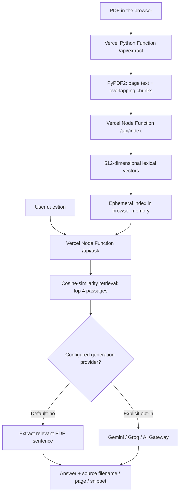

<div align="center">

# SourceLens

### Upload. Ask. Find.

**A document-grounded PDF question-answering workspace.**  
Upload a PDF, retrieve relevant passages, and inspect concise answers with page-level evidence.

[**Live demo**](https://sourcelens-rag.vercel.app) · [**Architecture & API**](docs/VERCEL_RAG.md) · [**Interview notes**](docs/INTERVIEW_GUIDE.md) · [**Report an issue**](https://github.com/Aryan10Ben/RAG-Docs/issues)

[](https://github.com/Aryan10Ben/RAG-Docs/actions/workflows/ci.yml)


</div>

---

> [!IMPORTANT]
> **Live deployment status:** The published default is **source-grounded, extractive PDF Q&A** using local lexical vector representations and cosine retrieval. It has been tested end to end. Optional **LLM-generated answers** using Gemini, Groq, or Vercel AI Gateway are implemented behind server-side configuration, but are **not enabled or live-verified** without provider credentials. Extractive Q&A is not the same as fully generative RAG.

## ✨ What you can do

| Capability | How it works | Status |
| :--- | :--- | :--- |
| PDF upload | Choose a file or drag and drop it into a translucent upload panel | ✅ Verified |
| Text extraction | Validate and parse selectable PDF text with page metadata | ✅ Verified |
| Passage indexing | Split into overlapping chunks; generate 512-dimension **hashed lexical vectors** | ✅ Verified |
| Document retrieval | Rank passages using cosine similarity (top 4) | ✅ Verified |
| Grounded answers | Extract a matching sentence from the retrieved content | ✅ Verified |
| Source references | Display filename, page number, and relevant text excerpt | ✅ Verified |
| Conversational workspace | Ask multiple questions; keep indexed documents within the tab | ✅ Verified |
| Generated answers | Optional Gemini Flash-Lite / Groq GPT-OSS / Vercel Gateway | ⚙️ Requires API setup |
| Persistent multi-user storage | User accounts, access control, durable vector database | Not implemented |

## 🖥️ Experience

A deliberately compact, dark interface: **matte-black background**, an original slowly revolving orbital globe, animated *Upload · Ask · Find* typography, SourceLens branding, and a translucent PDF dropzone with a gentle light sweep. Motion-sensitive visitors receive a reduced-motion version.

The upload flow leads to a focused reading workspace: document chips, a question composer, answer history, and expandable source passages. The interface explicitly distinguishes **extracted** and **AI-generated** answers.

**Try it:** [sourcelens-rag.vercel.app](https://sourcelens-rag.vercel.app)  
**Repository:** [github.com/Aryan10Ben/RAG-Docs](https://github.com/Aryan10Ben/RAG-Docs)

## 🧠 Architecture



**Why this design?** Vercel Functions are stateless; session vectors stay in the current browser tab and are supplied with each question. The default indexing and answering path needs **no third-party model key** and does not depend on the old Render deployment.

**Retrieval precision:** The active live version uses **lexical hashing**, not a pretrained semantic embedding network. It can miss paraphrases and does not perform LLM reasoning unless a provider is explicitly enabled. A separate, legacy Python implementation under [`backend/`](backend/) includes SentenceTransformers, FAISS, and Groq, but is **not** the deployed Vercel pipeline.

## 🛠️ Stack

| Layer | Technology |
| :--- | :--- |
| Frontend | React 19, Vite, modern CSS, SVG animation |
| PDF ingestion | Python, FastAPI, PyPDF2, Vercel Functions |
| Index & retrieval | JavaScript, hashed lexical embeddings, cosine similarity |
| Default answer | Extractive, sourced passages |
| Optional generation | Google Gemini 2.5 Flash-Lite / Groq GPT-OSS 20B / Vercel AI Gateway |
| Deployment | Vercel (single project for static app and API functions) |
| Verification | GitHub Actions, Node built-in test runner, pytest, Playwright, real-PDF smoke tests |

## 🚀 Run locally

```bash
git clone https://github.com/Aryan10Ben/RAG-Docs.git
cd RAG-Docs/frontend
npm ci
npm run dev
```

The Vite dev server provides the **UI only**. Because `/api/extract`, `/api/index`, and `/api/ask` are Vercel Functions, use the Vercel development environment (`vercel dev` with the project linked and the Vercel CLI installed) or deploy a preview to test uploads and answers. No LLM API key is needed for the extractive mode.

Validate the frontend and retrieval logic:

```bash
npm run lint
npm test
npm run build
```

For the actual hosted PDF-to-answer integration test, from the repository root:

```bash
python -m pip install requests reportlab
RAG_API_URL=https://sourcelens-rag.vercel.app python backend/tests/live_vercel_rag_smoke.py
```

The smoke test creates a **synthetic PDF** with a known answer (`481726`), then checks the live extraction, indexing, answer mode, answer value and source excerpts. It does **not** upload private files.

## ✅ Verification

The latest release-candidate checks include real uploads through Chromium and direct HTTP integration tests:

- **Browser:** PDF picker, drag/drop, invalid-file rejection, multiple factual questions, refusal of an unsupported question, source citations, mobile viewport and uncaught JS errors.
- **API:** `POST /api/extract` → `POST /api/index` → `POST /api/ask` against the hosted deployment, verifying a known answer and its page.
- **CI:** React lint/build, Node retrieval/provider-adapter tests, and Python API tests.

Evidence: [browser acceptance](https://github.com/Aryan10Ben/RAG-Docs/actions/runs/45679291385) · [real-PDF API test](https://github.com/Aryan10Ben/RAG-Docs/actions/runs/45679302905).

These results establish the **extractive** workflow, not the availability or quality of an unconfigured LLM provider.

## 🔌 Optional LLM-generated answers

The server-side `RAG_GENERATION_PROVIDER` variable defaults to extractive mode when unset.

| Provider | Environment variables | Notes |
| :--- | :--- | :--- |
| Google Gemini | `RAG_GENERATION_PROVIDER=gemini`, `GEMINI_API_KEY` | Default model: `gemini-2.5-flash-lite`; account-specific free quota |
| Groq | `RAG_GENERATION_PROVIDER=groq`, `GROQ_API_KEY` | Default: `openai/gpt-oss-20b`; rate-limited free plan |
| Vercel AI Gateway | `RAG_GENERATION_PROVIDER=vercel-gateway` | Requires eligible gateway access and billing setup |

**Add secrets in the Vercel dashboard, never in Git, in a `VITE_*` variable, or inside a public message.** Review free-tier data handling and add rate limiting before allowing model-backed public requests. After configuring a provider, run the live test with `RAG_EXPECTED_ANSWER_MODE=llm` and confirm source fidelity before describing the generated mode as operational.

See [deployment and API instructions](docs/VERCEL_RAG.md).

## ⚠️ Scope and limitations

- **PDFs:** selectable text only; scanned/image-only PDFs need OCR (not implemented).
- **Limits:** up to **3.5 MB**, **80 pages**, **60 chunks per upload**, **180 chunks per browser session**.
- **Privacy:** no sign-in or document ACLs. Do **not** upload confidential documents to this public demo.
- **Storage:** vector embeddings and conversation history are session-only in tab memory; refresh clears them.
- **Retrieval:** lexical similarity can overlook semantically equivalent wording; retrieved passages are evidence, not guaranteed truth.
- **Production hardening still needed:** authentication, abuse controls, durable storage, observability, OCR, evaluation datasets, and optional learned semantic embeddings.

## 🗺️ Next steps

Better semantic/hybrid retrieval · Evaluation of recall@k and faithfulness · Optional OCR · Authenticated persistent document sessions · Rate limiting and file-processing safeguards · Live verification of a configured LLM.

## 📄 Attribution and license

This repository evolved from an **existing collaborative, MIT-licensed PDF RAG application**. The original [MIT license](LICENSE) and copyright **© 2026 Jitendra Kumar Soni** are preserved. The interface redesign, Vercel-based source-grounded API, documentation, and regression tests have an auditable Git history. Please credit prior contributors when describing the project.

<div align="center">

**Built for exploring documents with verifiable evidence.**

[Live demo](https://sourcelens-rag.vercel.app) · [Technical documentation](docs/VERCEL_RAG.md) · [Source code](https://github.com/Aryan10Ben/RAG-Docs)

</div>
