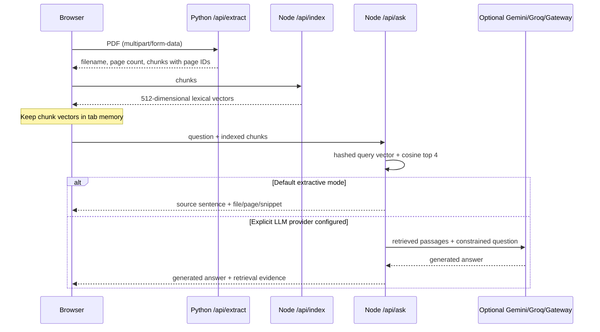

# SourceLens — Vercel architecture and API guide

**Audience:** Developers, contributors, and interview reviewers.  
**Repository:** [Aryan10Ben/RAG-Docs](https://github.com/Aryan10Ben/RAG-Docs) · **Site:** [sourcelens-rag.vercel.app](https://sourcelens-rag.vercel.app)

## 1. What is actually deployed

The active website is a **single Vercel project** whose root directory is `frontend/`. It serves the React/Vite client and three serverless endpoints:

| Function | Code | Purpose |
| --- | --- | --- |
| `GET/POST /api/extract` | `frontend/api/extract.py` | Validate and extract text and page metadata from a PDF |
| `GET/POST /api/index` | `frontend/api/index.js` | Produce deterministic lexical vectors from extracted chunks |
| `GET/POST /api/ask` | `frontend/api/ask.js` | Retrieve relevant chunks and return a sourced answer |

The UI calls these **same-origin** endpoints by default. No Render backend or Groq key is needed to use the **extractive** version.

> [!IMPORTANT]
> The **verified default** retrieves source passages using **hashed lexical vectors + cosine similarity** and returns an extractive answer. It does **not** use a pretrained dense/semantic encoder or an LLM by default. Calling it "full LLM-powered RAG" without enabling a provider would be inaccurate.

The older `backend/app/` implementation is separate (SentenceTransformers + FAISS + Groq). It is preserved for reference and local development; the Vercel UI does not call it.

## 2. Data flow



**State:** the index is intentionally kept in JavaScript memory in the browser. A refreshed tab loses its documents; no durable storage or user authentication exists.

## 3. API contracts

### Upload and extract

`POST /api/extract` with a multipart field named `file` containing a text-based PDF.

Sample successful JSON:

```json
{
  "status": "success",
  "filename": "silver-compass.pdf",
  "pages": 1,
  "chunks": [
    {
      "filename": "silver-compass.pdf",
      "page": 1,
      "text": "The certification number is 481726."
    }
  ]
}
```

This example is schematic; the actual parser may return a larger passage. Chunking is based on extracted characters with overlap, retaining page metadata. Rejections include malformed/empty files, non-PDF types, password-protected files, scanned PDFs without text, and input beyond the configured limits.

### Index text

`POST /api/index` with `{"chunks": [ ... ]}`, preserving each chunk's `text`, `filename`, and `page`.

Response includes `model: "local-hashed-lexical-v1"`, `chunks_added`, and `indexed` chunks with **512-number `embedding`** arrays and `embedding_model` metadata. These are **not** neural semantic embeddings.

### Ask a question

`POST /api/ask` accepts:

```json
{
  "question": "What is the certification number?",
  "chunks": ["The indexed chunk objects returned by /api/index"]
}
```

The `chunks` field in this example is a placeholder description, **not** a valid request: use the actual indexed objects from `/api/index` (which include numeric vectors).

A successful answer contains:

```json
{
  "answer": "The certification number is 481726. (Source: silver-compass.pdf, p. 1)",
  "answer_mode": "extractive",
  "sources": [
    {
      "filename": "silver-compass.pdf",
      "page": 1,
      "snippet": "The certification number is 481726.",
      "score": 0.558
    }
  ],
  "retrieval": {
    "method": "lexical vector cosine",
    "embedding_model": "local-hashed-lexical-v1"
  }
}
```

Scores in examples are illustrative. `score` is a retrieval-similarity signal, **not** a calibrated probability that an answer is true. Questions without sufficient overlap return a document-grounded refusal, not a model-generated guess.

Each endpoint also supports `GET` for a lightweight service/status response.

## 4. Supported limits

| Constraint | Value |
| --- | --- |
| File | PDF with extractable/selectable text |
| Upload size | 3,500,000 bytes (about 3.5 MB decimal) |
| Maximum PDF pages | 80 |
| Indexed chunks per upload | 60 |
| Indexed chunks per browser tab | 180 |
| Maximum extracted text across chunks per index call | 65,000 characters |
| Retrieval context for each question | top 4 passages |

Scanned/image-only PDFs and OCR are **not** supported. These limits protect the public demo from excessive serverless payloads, but are **not** a substitute for authentication, quotas, or abuse protections.

## 5. Vercel deployment

Link GitHub repository `Aryan10Ben/RAG-Docs` to a Vercel project and set:

| Setting | Value |
| --- | --- |
| Framework preset | Vite |
| Root directory | `frontend` |
| Build command | `npm run build` |
| Output directory | `dist` |
| Production Git branch | `main` |
| Functions | Auto-detect `frontend/api/*.py` and `frontend/api/*.js` |

`VITE_API_BASE_URL` should ordinarily be **unset/empty** so the frontend calls its own Vercel origin. Values beginning with `VITE_` are public browser build variables: never put an API key there.

After changing environment variables, deploy again so the runtime receives the new values.

### Provider configuration — optional

**Default:** omit `RAG_GENERATION_PROVIDER`. The answer API remains extractive and needs no API key.

| Provider | Server-only Vercel environment variables | Validation |
| --- | --- | --- |
| Gemini | `RAG_GENERATION_PROVIDER=gemini`, `GEMINI_API_KEY` | Obtain key through [Google AI Studio](https://aistudio.google.com/apikey), check free-tier eligibility |
| Groq | `RAG_GENERATION_PROVIDER=groq`, `GROQ_API_KEY` | Obtain key through [Groq Console](https://console.groq.com/keys), check rate limits |
| Vercel AI Gateway | `RAG_GENERATION_PROVIDER=vercel-gateway` | Requires Gateway entitlement, OIDC or valid server token, and billing eligibility |

Gemini's default model is `gemini-2.5-flash-lite` (override with `GEMINI_MODEL`). Groq defaults to `openai/gpt-oss-20b` (override with `GROQ_MODEL`). Provider models and free quotas can change; check your actual account before enabling an LLM.

**No production LLM integration has been live-verified in this project yet.** Adapter tests use mocked transports. For real model validation, securely set an API key, redeploy, and run a synthetic PDF test with `RAG_EXPECTED_ANSWER_MODE=llm`. The test must confirm a factual answer and cited passages. Enable public model requests only with sensible rate limiting and budget safeguards; Google free-tier data handling should also be reviewed.

## 6. Developer setup

```bash
git clone https://github.com/Aryan10Ben/RAG-Docs.git
cd RAG-Docs/frontend
npm ci
npm run lint
npm test
npm run build
npm run dev
```

`npm run dev` is **Vite frontend-only** and will not automatically expose Vercel Functions. To exercise the whole app, use a Vercel preview or a linked Vercel CLI development environment. Python function dependencies are in `frontend/requirements.txt`.

### Real deployed PDF test

From the repo root:

```bash
python -m pip install requests reportlab
RAG_API_URL=https://sourcelens-rag.vercel.app python backend/tests/live_vercel_rag_smoke.py
```

The script generates a harmless PDF with the answer `481726` and verifies each real endpoint, the returned fact, and supporting sources. It fails if the service is inaccessible, the answer is incorrect, or the expected mode is missing.

### Real browser test

```bash
python -m pip install playwright reportlab
python -m playwright install chromium
RAG_API_URL=https://sourcelens-rag.vercel.app python backend/tests/live_vercel_ui_smoke.py
```

The Chromium test exercises upload, drag/drop, invalid file handling, multiple questions, source citations, responsive layout and reduced-motion behavior. GitHub Actions runs the same tests against the release candidate. See [the latest PDF API run](https://github.com/Aryan10Ben/RAG-Docs/actions/runs/45679302905) and [browser run](https://github.com/Aryan10Ben/RAG-Docs/actions/runs/45679291385).

## 7. Security and privacy

**This project is a public portfolio demo, not a private document vault.**

- No authentication, per-user authorization, file antivirus scanning, or persistent encrypted storage.
- Do not upload private documents: the API processes uploaded PDF text in a serverless environment.
- Browser-held vectors and answers disappear on refresh; this is a UI/session behavior, **not** a guarantee about infrastructure logs or service retention.
- If an external LLM is enabled, retrieved passages are transmitted to its provider. Review the provider's terms and usage policies.
- For production multi-user use, add auth, ownership checks, explicit data retention/deletion controls, rate limiting, request-size enforcement, monitoring, and a durable index.

## 8. Known design trade-offs and next improvements

| Current trade-off | Suggested improvement |
| --- | --- |
| Lexical vectors miss paraphrases | Dense semantic embeddings, hybrid retrieval, reranking |
| No evaluation dataset | Retrieval recall@k, answer faithfulness, abstention testing |
| Session-only tab memory | Persistent vector store + document metadata |
| No scanned PDF support | OCR with resource limits |
| Public API without accounts | Authentication, quotas and abuse prevention |
| Optional LLM not live-enabled | Configure eligible provider; run end-to-end tests; manage cost |

The retained `backend/app` implementation includes SentenceTransformers, FAISS, and Groq; see [legacy backend notes](../backend/README.md) for the architectural distinction.

## 9. Historical deployment note

An earlier Render URL (`rag-doc-q-a.onrender.com`) timed out. This led to the present same-origin Vercel implementation. The incident and later Vercel verification are recorded in [LIVE_VERIFICATION.md](LIVE_VERIFICATION.md). **The historical Render failure does not describe the active Vercel deployment.**

---
Attribution: the original MIT license and copyright are preserved in [LICENSE](../LICENSE). This document describes the actual deployed pipeline rather than attributing all legacy code to subsequent contributors.
